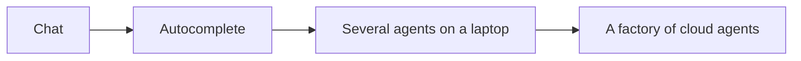
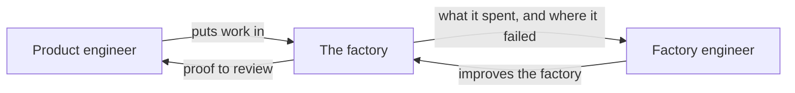
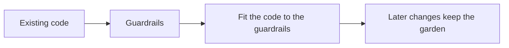
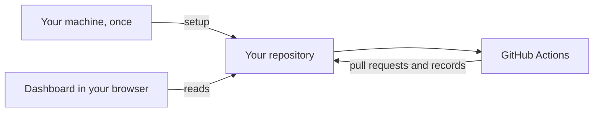
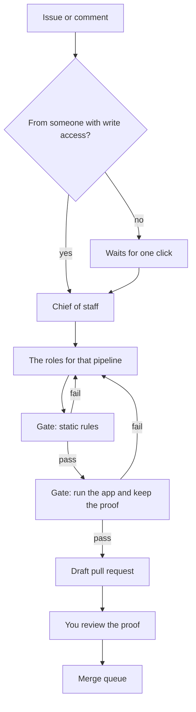
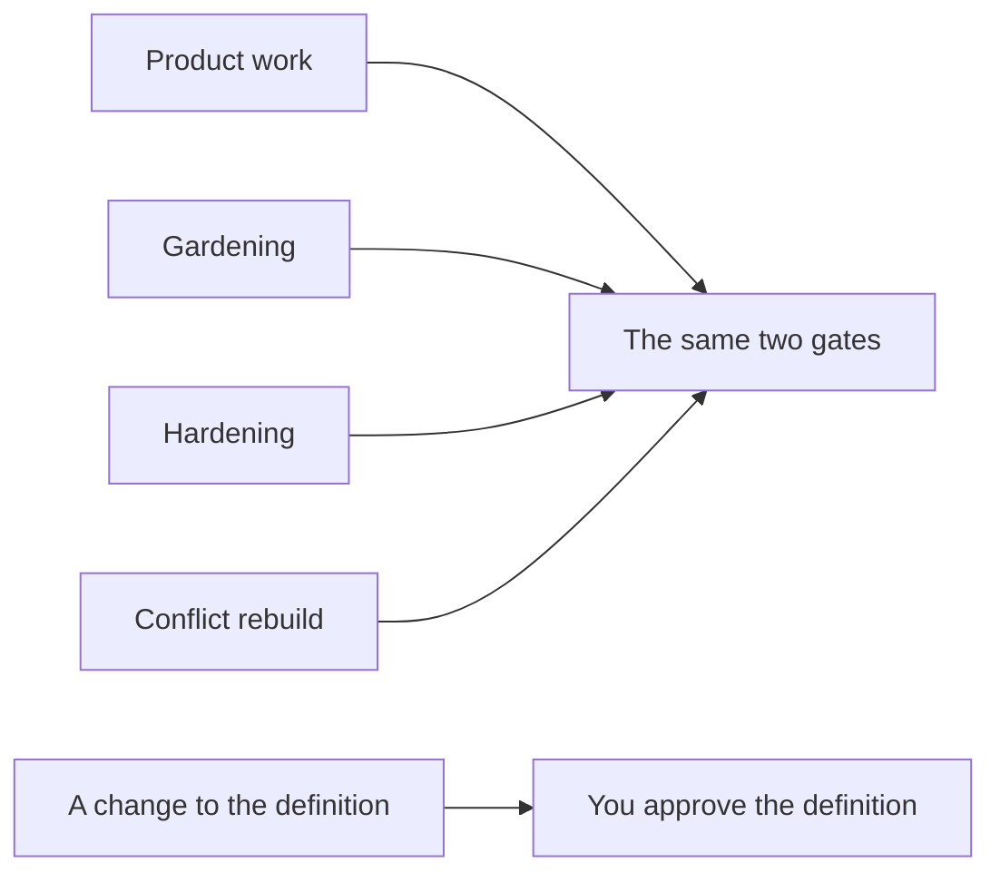
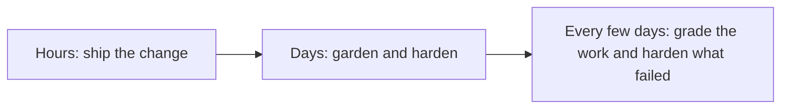
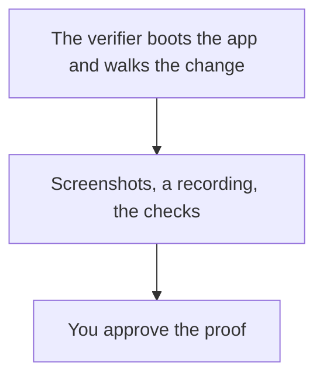

# Build Software Factory

_Built by Philip Valcin._

A software factory fully automates coding, from the start of a change to the end, and runs that work on sandboxed cloud agents. It is an open, adaptable infrastructure stack defined in code.

## What is an autonomous software factory?

Coding moved from a chat, to autocomplete, to several agents on a laptop, to a factory of cloud agents.



A factory is a governed loop. Work comes in, agents do it, and a person approves what lands. Every action is recorded, so the factory can be measured. It gets better from that record. The whole thing is files in the repository, so it can be read, versioned, and changed like any other code.

The shape of this idea comes from Zach Lloyd, founder of Warp: cloud agents, the factory defined in code, a product engineer and a factory engineer, and a garden kept clean because agents copy the code they see. The [dashboard](<docs/The Dashboard.md>) follows the shape of Warp's factory dashboard.

Two people work with it.



A product engineer puts work in and reviews the result. A factory engineer improves the factory itself: its checks, its instructions, and when a pipeline is allowed to merge on its own.

The codebase is the largest input the agents get, and they copy what they see. So the code is kept as a garden. Guardrails are the fence. They come from the codebase's own best patterns, from corrections people have already made, and from rules every codebase should have. Once the garden is clean, later changes have to keep it that way, and a correction that keeps coming back becomes a new guardrail.



The principles in full are in [Principles](docs/Principles.md). The checks themselves are in [Guardrails](docs/Guardrails.md).

## What this factory does, and how

This skill installs that factory into a repository you already have. After setup, nothing of it runs on your machine. GitHub Actions is the computer. The definition sits in the repository. A static dashboard reads that same repository from your browser.



You tell it what you want. A chief of staff turns that into one specific piece of work and picks the pipeline. The roles for that pipeline do the work. Two gates decide whether it may merge. You review the proof, then it joins the queue.



An issue from someone without write access waits. Its text stays out of every prompt until a trusted person accepts it.

Five ways work starts. The three that write product code, and a rebuilt conflict, all pass the same two gates. A change to the factory's own definition waits for a person either way.



- **Product work.** You say what you want. The factory triages it, writes a spec, builds it, and verifies it.
- **Gardening.** Every night the factory looks for debt, duplicated patterns, and behavior that landed without tests, and opens a small cleanup.
- **Hardening.** A correction, or a failure the review found, becomes a check for the whole codebase: a static rule, a stronger verification, or a refactor that makes the mistake impossible. The new check has to fail on the bad example and pass on the good one.
- **The definition.** `/practice` on an issue or pull request adds a standing instruction. You approve that pull request.
- **Conflicts.** When main moves under an open factory pull request, the factory rebuilds the change on the latest code and opens a fresh pull request.

Three clocks run at once.



The way a person trusts the result comes from Lauren Tan, a SpaceX engineer. Her pstack work has an agent boot the repository's own app, walk a journey, and keep the proof. This factory runs that check on GitHub Actions, in a sandbox. You review the screenshots, the recording, and the checks.



Product work, gardening, and hardening start with you merging, until you turn that pipeline's switch on. Setup's own pull requests are the exception: they merge on their own unless you say you will merge them by hand.

The monthly budget defaults to **$35**, split into product work 60%, gardening 25%, and reviews and practices 15%. Before any agent step starts, the factory reserves the most that step could cost. The step starts only when the month's spend, the reservations already held, and this step's reservation all fit. The mechanism is in [Budget](docs/Budget.md). The agents that do this work run on Claude Code, the harness whose spend that cap is proven to stop ([Architecture](docs/Architecture.md)).

On a public repository or a paid plan, GitHub can require the checks. On a free private repository the factory watches main after each push. The table is in [Security](docs/Security.md).

The factory reuses existing tools wherever one fits, and the map of what is reused and what is custom is in [Architecture](docs/Architecture.md).

## Start

You need a GitHub repository you administer, the [`gh` CLI](https://cli.github.com) signed in, Node 20 or later, and a coding agent that can load a skill folder ([Claude Code](https://code.claude.com), Cursor, Codex, or similar). The Anthropic key goes on GitHub, as the Actions secret `ANTHROPIC_API_KEY`. It does not go in the chat.

**1. Get the factory and give your agent the skill.**

The skill is linked, because its scripts install the factory's templates from the clone beside it.

PowerShell (Windows):

```powershell
git clone https://github.com/ChampPhil/build-software-factory "$HOME\build-software-factory"
New-Item -ItemType Directory -Force "$HOME\.claude\skills" | Out-Null
New-Item -ItemType Junction -Path "$HOME\.claude\skills\build-software-factory" -Target "$HOME\build-software-factory\skill"
```

bash (macOS, Linux):

```bash
git clone https://github.com/ChampPhil/build-software-factory ~/build-software-factory
mkdir -p ~/.claude/skills
ln -s ~/build-software-factory/skill ~/.claude/skills/build-software-factory
```

Those commands link it for Claude Code. For another agent, link the same `skill` folder into that agent's skills folder (Cursor: `~/.cursor/skills/build-software-factory`, Codex: `~/.codex/skills/build-software-factory`).

**2. In your repository, ask the agent to set it up.**

```
cd path/to/your-repo
> Set up the software factory on this repo.
```

**3. The steps that are yours.** The agent does the rest, and tells you the one thing it needs at each step.

| You | The agent |
| --- | --- |
| Paste `ANTHROPIC_API_KEY` on GitHub, on the Actions secrets page | Gives you that page, then watches for the secret |
| Press **Create**, then **Install**, on this repository only | Opens the two GitHub App pages |
| Say if you want to merge setup's own pull requests by hand | Otherwise those merge on their own. The other pipelines wait for a person |
| Merge a setup pull request, only if you said you would | Watches that pull request |
| Sign in to the dashboard once, from the link at the end | Gives that link when setup is finished |

The dashboard is [buildsoftwarefactory.com](https://buildsoftwarefactory.com). It is where you watch the factory, what it spent, and what needs you, and where you change its settings.

After that, open an issue. Comment `/practice` followed by the instruction on any issue or pull request to add a standing rule, and `/retry` to hand back something the factory stopped on.

The phases of setup are in [Setup](docs/Setup.md).

## Where to read next

| If you want | Open |
| --- | --- |
| The principles, the checks, and how a change is verified | [Principles](docs/Principles.md), [Guardrails](docs/Guardrails.md), [Verification](docs/Verification.md), [The Sandbox](<docs/The Sandbox.md>) |
| How work enters, who does it, and how it merges | [Triggers](docs/Triggers.md), [Roles](docs/Roles.md), [Pipelines](docs/Pipelines.md), [The Merge Queue](<docs/The Merge Queue.md>), [The Three Loops](<docs/The Three Loops.md>), [Self-Improvement](docs/Self-Improvement.md) |
| How it is installed, how it runs, what it costs, and where you watch it | [Setup](docs/Setup.md), [Architecture](docs/Architecture.md), [Budget](docs/Budget.md), [The Dashboard](<docs/The Dashboard.md>), [Security](docs/Security.md) |
| Why it is shaped this way, and the files it writes | [Decisions](docs/Decisions.md), [Schemas](docs/Schemas.md) |

## Developing

```bash
npm ci
npm test          # the runner's and the dashboard's tests
npm run lint
npm run typecheck
npm run schema-check   # the schemas against their frozen shape
```

`CONTRIBUTING.md` covers adding a rule pack. A new harness for the factory's own agents is only worth adding once a live test shows gh-aw's credit cap stops it (see `tests/live`).

## Licence

Apache License 2.0. See [`LICENSE`](LICENSE) and [`NOTICE`](NOTICE).
