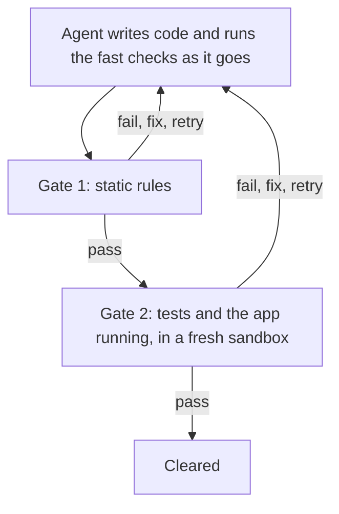

# Verification

Verification is how a change earns trust. The factory runs it. An agent's own report that the tests passed never counts.

The way a person trusts the result comes from Lauren Tan, a SpaceX engineer. Her pstack work has an agent boot the repository's own app, walk a journey, and keep the proof. This factory runs that check on GitHub Actions, in a sandbox. The proof is what you review.

## Kinds of verification

Verification is either runtime (run the code and watch it) or formal (prove it without running it).

- **Runtime verification** → run the code and check what it actually does. It shows the code works for the cases tried.
  - **Tests** → written in advance and scripted; same result every run.
    - **Unit** → one function, with everything around it faked.
    - **Integration** → a few real pieces working together (code + a real database).
    - **End-to-end (E2E)** → the whole app, used the way a user would.
  - **Agent runtime verification** → an agent uses the running app the way a developer would, with real dev tools. It explores, and it produces the screenshots and videos humans review.
- **Formal verification** → prove a property holds for *every* possible input. Strongest and most expensive; reserved for critical logic.

Tests differ by how much of the system they run:

| Type | What it runs | Example | Speed | Catches |
| --- | --- | --- | --- | --- |
| Unit | One function, everything around it faked | `calculateTax(100)` returns `8` | Milliseconds | Logic bugs in one piece |
| Integration | A few real pieces together | Saving a user writes the right database row, and reading it back returns the same user | Seconds | Wiring bugs: wrong queries, bad formats, schema mismatches |
| End-to-end | The whole app, used the way a person would | Sign up, log in, add to cart, check out | Slowest | Whether the product actually works |

Formal verification proves a property for every input, and it is reserved for critical logic: money, permissions, concurrency. During setup, a past correction about that kind of logic can become a formal check. In the clear loop it runs inside Gate 2 for the code it covers.

## How code becomes factory-clear

Three failed attempts on a gate escalate to a person. Every failure is recorded.

The factory runs both gates itself, so an agent's own "tests pass" never counts; only code that passes both is cleared.

- **Tests are protected** → tests can be rewritten or deleted in any pipeline, but only the existing tests the spec declared; new behavior must come with tests (diff coverage); total coverage can't fall more than a point below its highest; skips count as suppressions. Removing or loosening a rule needs a human.
- **The gates run apart from the builder** → in their own job, on every commit the factory pushes, and each commit is checked once.
- **Factory-clear is the shared unit** → every pipeline that produces code goes through it, and a resolved merge conflict goes through it again.

## The clear loop

Every pipeline that produces code ends in the same loop: the builder writes, the factory runs two gates, and only code that passes both is cleared.

1. **Builder writes code** in the sandbox, running the fast local checks as it goes. Each attempt reaches the work item's `factory/*` branch through gh-aw safe outputs: the first as a draft PR (`create-pull-request`, labelled `factory:in-progress`), later ones with `push-to-pull-request-branch`.
2. **The push starts `factory-gates`**, a separate job with no builder in it. Results are recorded against the commit, so nothing re-runs for the same commit. The path and test-edit rules are checked by `factory/policy`, which runs from main's copy of its workflow so a PR can't change it.
3. **Gate 1 — static:**
   - path and test-edit rules: `factory/policy` runs on the draft PR from main's copy of its workflow; a factory attempt that breaks them counts as a failed Gate 1 attempt
   - all static rules (repo tools + `.factory/guardrails/rules`), including the checkers setup declared in the sandbox's `static_checks`: each runs the repo's own checker and writes SARIF, which is counted per rule per file, so a language with no checker built into the factory is still gated
   - ratchet: no rule's count may rise in any file, read from each linter's native baseline (for example ESLint's `eslint-suppressions.json`) or, for tools without one, from `baselines.json`
   - weakening check
   - suppression control
4. **Gate 2 — verification** (in a fresh sandbox):
   - full test suite (or, where the repo already has a CI test check that runs on factory branches, that check's result on the same commit; if it hasn't reported within 15 minutes, the gate runs the tests itself)
   - coverage, from the report the sandbox's `commands.coverage` writes at `coverage_report` (the tests gate runs that command instead of `commands.test`, once): diff coverage ≥ 80% (the main check), over the changed executable lines where the report records per-line hits (lcov, Cobertura), else over the changed files, total ≥ floor (one point below the highest total reached), skips within cap
   - formal checks where installed
   - mutation testing on changed lines (from v0.2), with each language's existing tool (StrykerJS, Stryker.NET, cargo-mutants, Infection and the rule pack's equivalents)
   - **agent runtime verification**: the verifier starts the app per the runbook, exercises the change with real dev tools (a browser through Playwright MCP, console, network, database), and records one screen video of the whole verification (a chapter per acceptance check) plus screenshots and traces
5. **Fail** at either gate → the failure output goes back to the builder, which fixes and resubmits. Each gate allows **3 attempts per work item**; the third failure escalates.
6. **Pass both** → code cleared: the draft PR's label changes from `factory:in-progress` to `factory:cleared`, and its body is filled in with the evidence.

Every attempt, pass or fail, is recorded in the run file's `gates` list.

## The proof on the pull request

Every factory PR, setup PR and escalation is rendered by the runner from the
roles' reports (`schema/pr-report.json`), never from text an agent wrote into
the PR. One layout everywhere:

1. **Summary** — at most three lines: what changed, why, what someone would notice.
2. **Proof** — an ordered mix of files (screenshots, GIFs, recordings, logs,
   API responses) and Mermaid diagrams, as many as the change needs: the
   builder's, then the verifier's under "Checked independently by the
   verifier". Images show inline; a video shows its poster linking to the
   file, since GitHub plays only its own uploads; text proof shows inline.
   When the body cannot hold it all, the rest continues in one PR comment.
   Recordings are made to fit by `bsf report store` before anything is stored
   (`runner/src/lib/recordings.ts`, needs ffmpeg, which Playwright installs on
   the runner): an H.264 MP4 under 8 MB a clip and 24 MB a PR, a GIF preview of
   at most 20 s, the original kept only as a workflow artifact. A UI-touching
   change (`ui_change: true` in the spec) fails the check with no video.
3. **Key things to focus on** — the biggest changes to be aware of.
4. **Read more** — the full spec, a technical and a conceptual breakdown.

Files are stored on `refs/factory/media` under `reports/<work item>/`, and each
has a URL there. `bsf report store` stores a role's report in its post-step;
`bsf report publish` renders the PR in `factory-run` (once with the builder's
report, again when the verifier's is in) and reports `factory/pr-report`,
which fails and names the part that is missing. Setup PRs are rendered with
`bsf report setup`, the trial's screenshot of the app first.

What the reviewer is judging depends on the pipeline. The table is in [Pipelines](Pipelines.md).
